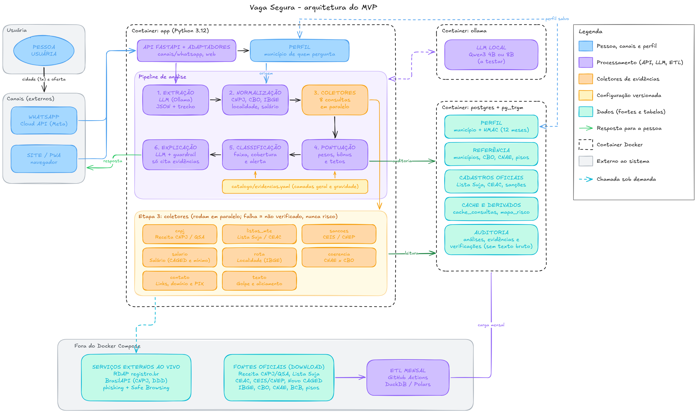

# Vaga Segura

Ferramenta de código aberto que cruza dados públicos brasileiros (Receita Federal, Cadastro de Empregadores do MTE, Novo CAGED) com IA local para identificar indícios de aliciamento para trabalho análogo à escravidão em ofertas de emprego.

Projeto criado para o programa AI4Good da Brazil Conference 2027.

> O Vaga Segura aponta indícios a partir de dados públicos. Ele não acusa empresas nem substitui a fiscalização. Em caso de suspeita, denuncie pelo [Sistema Ipê](https://ipe.sit.trabalho.gov.br/) ou pelo Disque 100.

## Como funciona

1. A pessoa informa uma vez a cidade onde mora e depois encaminha a oferta pelo WhatsApp ou cola no site, em texto ou print.
2. Um modelo de linguagem rodando localmente extrai o que pode ser verificado: empresa, CNPJ, cargo, salário, local, benefícios e cobranças.
3. Coletores consultam bases públicas: situação do CNPJ e sócios, Lista Suja e CEAC, sanções da CGU, salário do cargo na região e salário mínimo, se a vaga é fora do município ou da região de quem pergunta, domínio e contatos.
4. Cada verificação gera evidências com peso definido no catálogo, e o motor calcula uma pontuação de confiança.
5. O resultado volta em linguagem simples, com as evidências, orientações e os canais oficiais de denúncia.



## Status

O projeto está na fase de especificação. Os contratos entre os módulos, o catálogo de evidências e o esquema do banco estão prontos e são validados por testes. Coletores, motor de cálculo, ETL, API e bot do WhatsApp ainda não foram implementados; o plano está no [escopo do MVP](docs/escopo-mvp.md).

## Estrutura

```
app/modelos/     contratos entre os módulos (Pydantic)
catalogo/        pesos, tetos e base legal das evidências
db/              esquema do banco (PostgreSQL 15+)
schemas/         JSON Schemas gerados a partir dos modelos
scripts/         geração dos schemas e validação do catálogo
tests/           testes dos contratos e do catálogo
docs/            documentação do projeto
```

## Documentação

- [Resumo do projeto](docs/resumo.md)
- [Escopo do MVP](docs/escopo-mvp.md) e [roteiro de evolução](docs/roteiro.md)
- [Contratos entre os módulos](docs/arquitetura/contratos.md)
- [Bases de dados consultadas](docs/arquitetura/bases-de-dados.md)
- [Modelo de dados](docs/arquitetura/modelo-de-dados.md)
- [Referências jurídicas](docs/referencias/juridico.md) e [pesquisa](docs/referencias/pesquisa-pradhan-shehory-2026.md)

## Licença

Código sob a [Licença Apache 2.0](LICENSE). Os dados consultados pertencem às suas fontes; veja as [atribuições](ATRIBUICOES.md).
