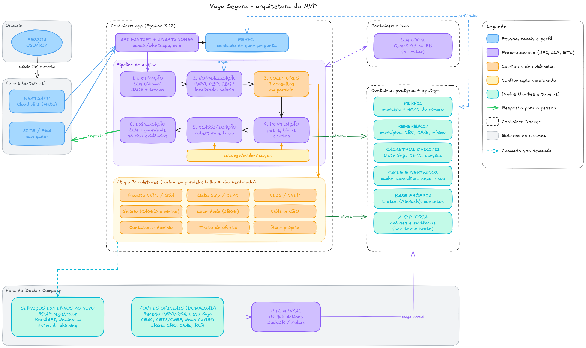

# Contratos entre os módulos

Cada etapa do motor conversa com a seguinte por um formato fixo, definido em Pydantic. Assim cada pessoa da equipe consegue trabalhar no seu módulo sem depender do código das outras, e qualquer mudança de formato aparece na revisão.



## Fluxo

```
EntradaAnalise -> [1. Extração] -> ExtracaoOferta -> [2. Normalização] -> Normalizacao
               -> [3. Coletores] -> ResultadoColetor (x9) -> [4. Pontuação] -> [5. Classificação] -> [6. Explicação] -> ResultadoAnalise
```

| Etapa | Recebe | Devolve | Onde está o formato |
|---|---|---|---|
| Entrada (API e webhook do WhatsApp) | Texto da oferta ou do print, canal de origem e o município do perfil do usuário | `EntradaAnalise` | `app/modelos/extracao.py` |
| 1. Extração (IA local) | `EntradaAnalise` | `ExtracaoOferta` | `app/modelos/extracao.py` e `schemas/extracao.schema.json` |
| 2. Normalização (regras) | `ExtracaoOferta` | `Normalizacao` | `app/modelos/extracao.py` |
| 3. Coletores | `ExtracaoOferta` + `Normalizacao` | `ResultadoColetor` | `app/modelos/evidencia.py` |
| 4. Pontuação | Todos os `ResultadoColetor` + catálogo | Pontuação e tetos aplicados | `app/modelos/catalogo.py` e `catalogo/evidencias.yaml` |
| 5. Classificação | Pontuação + verificações | Cobertura e faixa | `catalogo/evidencias.yaml` (faixas) |
| 6. Explicação | Evidências + pontuação | `ResultadoAnalise` | `app/modelos/evidencia.py` |

## Contrato 1: extração e normalização

`ExtracaoOferta` é o que a IA devolve. O mesmo modelo gera o `schemas/extracao.schema.json`, que vai para o Ollama como formato obrigatório da resposta, então a IA não consegue devolver um JSON fora do padrão.

Todo dado extraído carrega o trecho literal do texto que o justifica (`Campo.trecho`). Antes de seguir, conferimos se o trecho existe mesmo no texto original. Campo sem trecho válido é descartado.

Campos extraídos: empresa (nome e CNPJ), recrutador, cargo, quantidade de vagas, salário (valor e período), local de trabalho (com a modalidade: presencial, remoto ou híbrido), benefícios (incluindo adiantamento), cobranças, descontos no salário, forma e momento do pagamento, contrato, contatos (telefones, e-mails, links, chaves PIX) e sinais de texto (urgência, dispensa de requisitos, pedido de documentos originais, compra em estabelecimento indicado, entre outros).

`Normalizacao` é feita só com regras, sem IA: CNPJ com dígitos validados, nome da empresa normalizado, código CBO do cargo, municípios de origem e destino no código do IBGE, a relação entre eles (ver a próxima seção), salário mensal estimado, salário mínimo de referência, domínios e DDDs.

## Perfil e localidade

O município de origem vem do perfil: a pessoa informa uma vez onde mora. No WhatsApp, o bot pergunta na primeira conversa e guarda só o município, ligado a um HMAC do número (tabela `perfis_usuario`). No site, o perfil fica no próprio navegador. Escolaridade e outros dados pessoais não são pedidos, porque nenhuma regra do catálogo usa essas informações (LGPD, art. 6º, III).

Com o município da pessoa e o da vaga, a normalização preenche `relacao_localidade`:

| Valor | Quando | Efeito |
|---|---|---|
| `mesmo_municipio` | A vaga é no município onde a pessoa mora | Evidências de deslocamento não se aplicam |
| `mesma_regiao_imediata` | Outro município da mesma região geográfica imediata | Vale o art. 207 do CP (outra localidade), com peso menor |
| `outra_regiao_imediata` | Fora da região imediata, em outra UF ou no exterior | Vale o art. 207, com peso maior |
| `nao_se_aplica` | Trabalho remoto | Evidências de deslocamento ficam como `nao_aplicavel` |
| `desconhecida` | Sem perfil ou sem local da vaga | Evidências de deslocamento ficam como `sem_dados` |

A região geográfica imediata é a divisão do IBGE que agrupa municípios em torno de um centro urbano, pelo deslocamento diário para trabalho, comércio e serviços. Ela substitui o limite de 300 km da versão anterior, que não tinha base em norma nem em pesquisa. O art. 207 fala só em "outra localidade", então qualquer vaga fora do município já conta. A diferença de peso entre os dois casos é um parâmetro inicial, a calibrar com o conjunto de teste.

## Contrato 2: evidências

Todo coletor segue a mesma assinatura:

```python
async def coletar(extracao: ExtracaoOferta, norm: Normalizacao) -> ResultadoColetor
```

`ResultadoColetor` tem duas listas:

- `verificacoes`: cada checagem tentada, com status `concluida`, `nao_aplicavel`, `falhou` ou `sem_dados`. É daqui que sai a cobertura da análise.
- `evidencias`: os fatos encontrados, cada um com o id do catálogo, a fonte, a data da fonte, o trecho da oferta, o valor observado e a referência de comparação.

Regras:

- Fonte que falha vira `falhou`, nunca evidência de risco.
- O coletor não decide pontos. Os pontos vêm do catálogo e são aplicados pelo motor.
- `confianca_coleta` (de 0 a 1) indica a qualidade do dado. Um cruzamento aproximado, por exemplo, entra com valor menor que 1.

Os 9 coletores: `cnpj`, `listas_mte`, `sancoes`, `salario`, `coerencia`, `rota`, `contato`, `texto` e `base_propria`.

## Contrato 3: catálogo

`catalogo/evidencias.yaml` é a única fonte de pesos, tetos e base legal. O código do motor só lê esse arquivo. O validador em `app/modelos/catalogo.py` recusa o catálogo se:

- uma evidência de risco tiver pontos positivos (ou o contrário);
- houver id repetido;
- um teto, uma evidência (`aplica_quando`) ou um indicador de combinação usar uma condição que não foi definida;
- uma combinação apontar para uma evidência que não existe.

Na etapa 4, o motor faz a soma ponderada das evidências e aplica o bônus de combinação (indicadores do PL 1636, art. 2º, IV), o ajuste de ausência por setor e os tetos. Na etapa 5, calcula a cobertura e define a faixa.

## Resultado final

`ResultadoAnalise` traz a pontuação (0 a 100), a faixa (`alto_risco`, `atencao`, `sem_sinais_relevantes` ou `inconclusivo`), a cobertura, os tetos aplicados, as evidências, as verificações e a explicação. Cada item da explicação aponta para o id de uma evidência, e o guardrail recusa qualquer item que não tenha uma evidência correspondente.

## Versões

Cada análise registra `versao_esquema` (formato da extração) e `versao_catalogo` (pesos usados). Mudou um campo ou um peso, sobe a versão. Isso permite comparar análises antigas e novas na calibração.
