# Modelo de dados

Esquema completo em [`db/schema.sql`](../../db/schema.sql). PostgreSQL 15+ com a extensão `pg_trgm` (busca de nomes parecidos).

## Visão geral

```mermaid
erDiagram
    fonte_carga ||--o{ empregadores_mte : "carga"
    fonte_carga ||--o{ sancoes : "carga"
    fonte_carga ||--o{ salarios_cbo : "carga"
    fonte_carga ||--o{ cnae_cbo_compatibilidade : "carga"
    fonte_carga ||--o{ mapa_risco : "carga"
    cbo_ocupacoes ||--o{ cbo_sinonimos : "tem"
    cbo_ocupacoes ||--o{ salarios_cbo : "cargo"
    municipios ||--o{ empregadores_mte : "local"
    municipios ||--o{ mapa_risco : "local"
    municipios ||--o{ perfis_usuario : "mora"
    cnae_subclasses ||--o{ empregadores_mte : "atividade"
    analises ||--o{ analise_evidencias : "gera"
    analises ||--o{ analise_verificacoes : "registra"

    fonte_carga {
        bigint id PK
        text fonte
        date data_referencia
        timestamptz carregado_em
        text hash_arquivo
    }
    empregadores_mte {
        bigint id PK
        text cadastro "lista_suja ou ceac"
        text documento_tipo "cnpj ou cpf"
        text documento
        text nome_normalizado
        char municipio_ibge FK
        char cnae FK
    }
    sancoes {
        bigint id PK
        text cadastro "ceis ou cnep"
        text documento
        date data_fim
    }
    municipios {
        char codigo_ibge PK
        text nome_normalizado
        char uf
        char regiao_imediata
        float latitude
        float longitude
    }
    cbo_ocupacoes {
        char codigo PK
        text titulo
        char familia
    }
    cbo_sinonimos {
        char codigo FK
        text sinonimo_normalizado
    }
    cnae_subclasses {
        char codigo PK
        text descricao
        char divisao
    }
    cnae_cbo_compatibilidade {
        char cnae_divisao PK
        char cbo_familia PK
        numeric proporcao
    }
    salarios_cbo {
        char cbo_codigo PK
        text nivel PK "municipio, uf, brasil"
        text chave_geo PK
        numeric p10
        numeric p50
        numeric p90
    }
    salario_minimo_pisos {
        int id PK
        char uf "NULL = nacional"
        numeric valor_mensal
        text ato_normativo
        date vigencia_inicio
    }
    mapa_risco {
        char municipio_ibge PK
        char cnae_divisao PK
        int casos
    }
    cache_consultas {
        text fonte PK
        text chave PK
        jsonb resposta
        timestamptz expira_em
    }
    base_textos {
        bigint id PK
        bigint_array assinatura "MinHash"
        int ocorrencias
    }
    base_contatos {
        text contato_tipo PK
        text contato_hash PK
        text empresa_hash PK
        int ocorrencias
    }
    perfis_usuario {
        text contato_hash PK "HMAC"
        char municipio_ibge FK
        timestamptz atualizado_em
    }
    analises {
        uuid id PK
        text versao_catalogo
        text canal "web ou whatsapp"
        text relacao_localidade
        smallint pontuacao
        text faixa
        numeric cobertura
    }
    analise_evidencias {
        uuid analise_id PK
        text evidencia_id PK
        smallint pontos_aplicados
    }
    analise_verificacoes {
        uuid analise_id PK
        text coletor PK
        text status
    }
```

## Grupos de tabelas

| Grupo | Tabelas | Atualização | Quem usa |
|---|---|---|---|
| Controle | `fonte_carga` | A cada carga do ETL | Auditoria (de onde e de quando veio cada dado) |
| Referência | `municipios`, `cbo_ocupacoes`, `cbo_sinonimos`, `cnae_subclasses`, `salario_minimo_pisos` | Rara (anual). O salário mínimo vem do SGS do Banco Central | Normalização e coletores |
| Derivadas do CAGED | `salarios_cbo`, `cnae_cbo_compatibilidade` | Mensal | Coletores `salario` e `coerencia` |
| Cadastros oficiais | `empregadores_mte` (Lista Suja + CEAC), `sancoes` (CEIS + CNEP) | Mensal | Coletores `listas_mte` e `sancoes` |
| Derivada da Lista Suja | `mapa_risco` | Mensal | Coletor `rota` |
| Cache | `cache_consultas` | Sob demanda (TTL) | Coletores `cnpj` e `contato` |
| Base própria | `base_textos`, `base_contatos` | A cada análise | Coletor `base_propria` |
| Perfil | `perfis_usuario` | Quando a pessoa informa ou muda a cidade | Normalização (município de origem) |
| Auditoria | `analises`, `analise_evidencias`, `analise_verificacoes` | A cada análise | Métricas e calibração |

## Regras de privacidade (LGPD)

- Nenhuma tabela guarda o texto da oferta nem os trechos. A base própria guarda só a assinatura MinHash e HMACs.
- CPF da Lista Suja: fica em `empregadores_mte.documento` apenas para o cruzamento e nunca é exibido.
- Auditoria agregada: `analises` registra só a UF de origem e de destino, nunca o município ou o contato.
- Perfil: `perfis_usuario` guarda só o município, ligado ao HMAC do número. É apagado a pedido da pessoa ou depois de 12 meses sem uso.
- HMAC com segredo do servidor em `base_contatos`: sem o segredo, não dá para descobrir qual telefone gerou o hash.

## Regra contra homônimos (coletor `listas_mte`)

| Tipo de cruzamento | Evidência gerada |
|---|---|
| CNPJ exato, CPF exato, CPF de sócio exato | `lista_suja_documento` (forte, teto 10) |
| Nome + município + dígitos visíveis do CPF no QSA | `lista_suja_documento` |
| Só nome parecido (`pg_trgm` com similaridade ≥ 0,8) | `lista_suja_nome_semelhante` (fraca, −5) |
